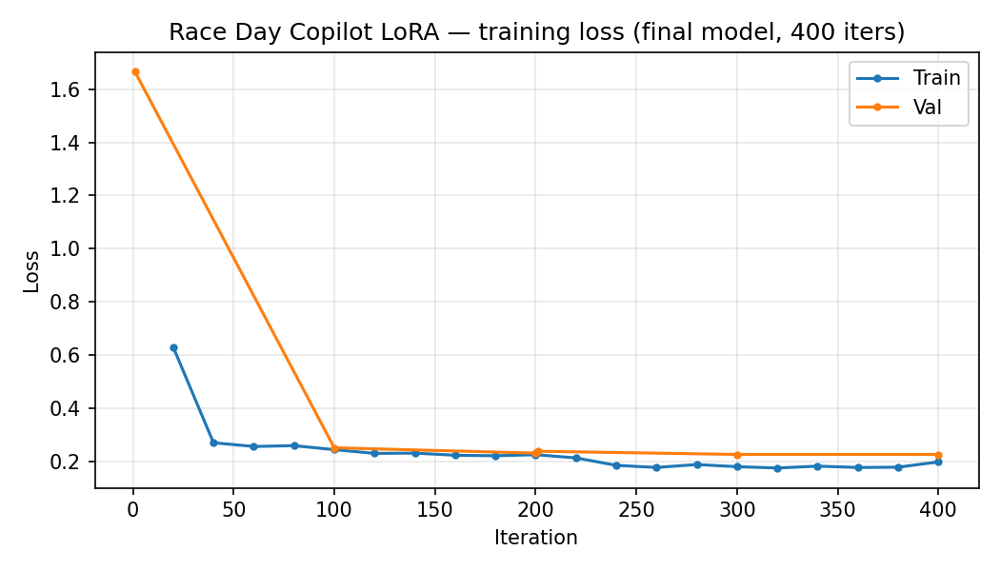

# Race day copilot

Photograph a race course map and you get a km-by-km pacing plan that has already passed six deterministic checks. The repo also has a LoRA fine-tune of Qwen2.5-3B, distilled from Claude, that tries to do the same job locally.

[Live site](https://lyhjeremy.github.io/race-day-copilot/) · [Write-up](https://lyhjeremy.github.io/race-day-copilot/overview/) · [Long-form notes](writeup.md) · [Benchmark](eval/benchmark.md)

Design and copy follow [these standards](https://github.com/lyhjeremy/lyhjeremy/blob/main/DESIGN_STANDARDS.md).

## Results

All three systems saw the same prompt on 70 held-out scenarios (split by scenario id, seed 42, 90/5/5), zero-shot with no retries:

| System | Parse success | Passes all checks | Latency (s/plan) |
|---|---|---|---|
| Qwen2.5-3B base, no fine-tune | 55.7% | 0.0% | 17.5 |
| Qwen2.5-3B + LoRA (this project) | 95.7% | 0.0% | 53.7 |
| Claude teacher, zero-shot | 90.0% | 75.7% | 157.7 |

The LoRA student learned the format (it fails coverage on 2.9% of plans, plausibility on 1.4%, heat on 4.3% and citations on none) and did not learn the arithmetic: 82.9% of its plans miss the goal by more than 90 seconds, and 91.4% report a `fade_allowance_pct` that doesn't match their own splits. In 60 blind, position-swapped LLM-judge comparisons, the teacher was preferred 93.3% of the time, the student 0%, with 6.7% ties. The full per-check table is in [`eval/benchmark.md`](eval/benchmark.md). The [write-up page](https://lyhjeremy.github.io/race-day-copilot/overview/) lays the teacher's and the student's archived plans over each other for 31 held-out scenarios, which shows the student's cumulative times drifting away from the goal.

<p align="center">
  
</p>

## How it works

1. **Vision.** `src/vision.py` runs Tesseract OCR on the photo, then `claude -p` parses the text into a `CourseProfile` (distance, hill segments with trend and severity, confidence). Photos that aren't course maps get a refusal, and no vision API key is involved.
2. **Retrieval.** 14 knowledge cards of pacing research plus findings digests, embedded locally with sentence-transformers.
3. **Context engineering.** A priority-based `ContextBudgeter` packs the course, runner brief and retrieved cards into a token budget and reports each section's allocation (`ContextBudgeter.pack().report`). Teacher and student get the identical assembled prompt.
4. **Generation.** Claude or the local LoRA model returns a Pydantic `PacingPlan`: per-km paces, predicted finish, fade allowance, heat adjustment, cautions, citations.
5. **Verification.** [`src/verifier.py`](src/verifier.py) runs six checks and returns each violation as a sentence; violations go back into the prompt for up to two retries.
   - Coverage: one split per km plus the partial final km.
   - Sum: splits total the goal within 90 seconds (or the plan's own predicted finish if it flags the goal as unrealistic).
   - Plausibility: no split more than 12% slower than mean pace (20% on steep climbs), no downhill split more than 20% faster.
   - Fade: second half 0 to 8% slower, or a negative split flagged with a caution citing the 2.5% base rate; `fade_allowance_pct` must match the splits within 0.5 points.
   - Heat: at 18°C or above, an adjustment of 0.75 to 4.5 s/km per degree over 15°C, derived from my [Boston heat-tax finding](https://github.com/lyhjeremy/marathon-heat-tax) of about 1 minute per °F.
   - Citations: at least one, and only retrieved ids.
6. **Distillation.** 1,458 verifier-passed teacher plans (96.0% of 1,519 generation attempts) across 6 course profiles, 14 goal times, 6 temperatures and 3 experience levels, split 1,321 / 67 / 70 with a leakage check. LoRA on `mlx-community/Qwen2.5-3B-Instruct-4bit` with MLX: 16 layers, batch size 1, gradient accumulation 4, learning rate 5e-5, max sequence length 4,608, gradient checkpointing, gradient clipping at 1.0.

Earlier versions of this README counted five checks; the citation rule is the sixth and is scored in the benchmark.

## Training notes

Training took four attempts over two days. The planned sequence length (1,536) was 2.7 times shorter than the longest training example (4,197 tokens, measured with the Qwen tokenizer). Without gradient checkpointing the 16 GB Mac ran out of memory and training printed `Train loss 0.000` and `Trained Tokens 0` instead of crashing. Loss then diverged three times, including once with a custom training loop (`training/lora_harness/train_clipped.py`) that adds gradient clipping, which `mlx_lm.lora`'s CLI doesn't expose; gradient norms stayed at 0.18 to 0.35, so clipping never engaged. The published adapter is the best checkpoint, about 400 clean iterations at validation loss 0.226. My untested next hypothesis is the constant learning rate; [`writeup.md`](writeup.md) has the details.

## Stack

Python, Tesseract (pytesseract), Claude CLI, sentence-transformers, Pydantic, MLX (`mlx_lm`), Qwen2.5-3B-Instruct, Gradio.

## How to run

```bash
pip install -r requirements.txt
python scripts/make_example_courses.py       # 6 course fixtures (committed)
python scripts/gen_scenarios.py              # scenario generation (long-running, resumable)
python training/prep_scenarios.py            # scenario-id split train/valid/test
python training/lora_harness/train_clipped.py --model mlx-community/Qwen2.5-3B-Instruct-4bit \
    --data data/lora --train --batch-size 1 --num-layers 16 --iters 1000 \
    --learning-rate 5e-5 --grad-accumulation-steps 4 --max-seq-length 4608 \
    --adapter-path training/adapters --grad-checkpoint --max-grad-norm 1.0
python app.py                                # Gradio app
```

`setup_ocr.sh` installs Tesseract. Everything runs locally except the `claude -p` calls for course extraction and generation, which run on a Claude subscription with no metered API.

## Repo layout

| Path | What it is |
|---|---|
| `app.py` | Gradio app: photo, brief, plan, verification, text-to-speech |
| `src/verifier.py` | The six deterministic plan checks |
| `src/copilot.py` | Prompt assembly, identical for teacher and student |
| `src/` | Shared toolkit: llm, vision, guardrails, context, cache, schemas |
| `scripts/gen_scenarios.py` | Resumable scenario generator (teacher plus verifier) |
| `scripts/make_example_courses.py` | Hand-built `CourseProfile` fixtures (6 archetypes) |
| `training/prep_scenarios.py` | Scenario-id split with a leakage check |
| `training/lora_harness/train_clipped.py` | `mlx_lm.lora` loop plus gradient clipping |
| `training/bench_copilot.py` | Three-way benchmark and blind pairwise judge |
| `tests/test_verifier.py` | Verifier tests |
| `eval/` | Benchmark, judge outputs, loss curves, dataset card |

## Limitations

- No held-out student plan passed every check, so the local model isn't usable on its own yet.
- Test scenarios use the same six synthetic course profiles as training; photographed maps and unseen course shapes aren't benchmarked.
- The LLM judge is Claude, which is also the teacher.
- Archived raw outputs in `eval/raw_outputs_*.json` were truncated at 4,000 characters when saved. Scoring ran on the full text, so the metrics stand.

## License

[MIT](LICENSE) © 2026 Jeremy Lee
