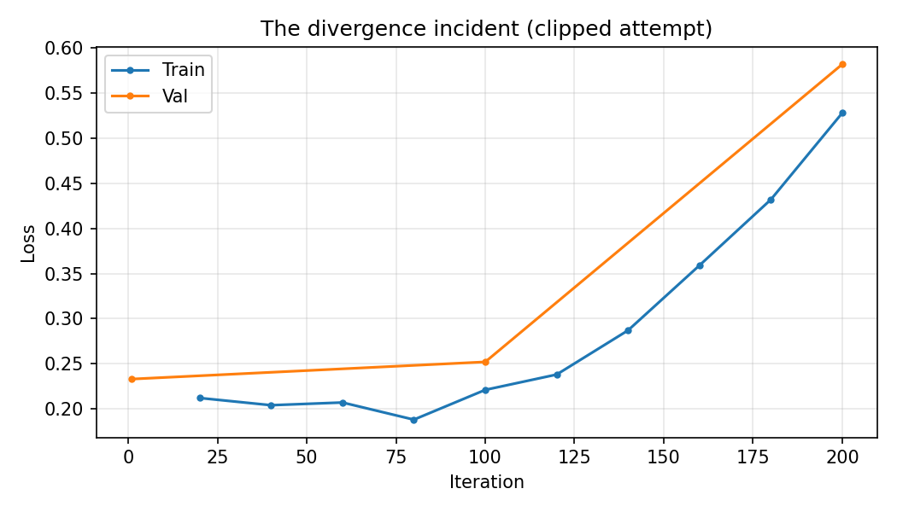

# Race day copilot: the hardest fine-tune of five, and what went wrong building it

*Photograph a race course map, state a goal time, and get a km-by-km pacing plan that has passed deterministic checks before you see it. A locally fine-tuned model, distilled from Claude, tries to produce the same plans without an API call.*

## The idea

I've run 14 marathons (my best is 2:48 in Berlin), and a pacing plan is only useful if its numbers hold together. Ask a chatbot for one and you're trusting it to do arithmetic across 42 rows, to reason about hills it can't see as numbers, and to resist handing you an aggressive negative-split strategy that almost nobody pulls off. Race day copilot is built around one rule from `RACE_DAY_COPILOT_SPEC.md` §2: a plan is never shown to the runner until it passes checks written in plain code. A model that gets the shape of a plan right and the arithmetic wrong doesn't get to call it a passing plan.

It is the last of five small apps that each exercise the same five skills (fine-tuning, guardrails, multimodal input, context engineering and token optimization), and the one where all five were tested hard, including a few that weren't supposed to be the difficult part.

## The verifier: every violation is a sentence

`verify()` in `src/verifier.py` returns a list of violation strings, and an empty list is a pass. The strings go straight into a bounded retry loop during scenario generation, so each one has to make sense to an LLM that has no other context.

1. **Coverage.** Exactly one split per km, plus the correct partial final row for non-integer distances.
2. **Sum.** Split times add up to the stated goal within 90 seconds, or, if the plan flags the goal as unrealistic, to its own `predicted_finish`.
3. **Plausibility.** No split is more than 12% slower than the mean pace (20% on a steep climb), and no downhill split is more than 20% faster.
4. **Fade.** A negative split is allowed only if a caution flags it as aggressive and cites the 2.5% base rate from my [negative-split analysis](https://github.com/lyhjeremy/marathon-negative-split-myth). Otherwise the second half must be 0 to 8% slower, and the model's `fade_allowance_pct` must match what its splits compute within 0.5 points.
5. **Heat.** At 18°C or above, `heat_adjustment_s_per_km` must fall between 0.75 and 4.5 seconds per degree above 15°C, a band derived from my [heat-tax analysis](https://github.com/lyhjeremy/marathon-heat-tax) (about 1 minute slower per °F on the Boston field median).
6. **Citations.** At least one citation, and only ids that were retrieved for that prompt.

Earlier versions of this write-up counted five checks. The citation rule lives in the same function and is scored in the benchmark, so it is listed here as the sixth.

## Scenario generation: 1,458 accepted

The training data is 1,458 teacher-generated, verifier-passed scenarios across 6 course archetypes (5 marathon-scale, 1 half marathon), 14 goal times, 6 temperatures and 3 experience levels. `claude -p` generated them with the same prompt assembly the live app uses, with up to 2 retries against verifier feedback; 1,458 of 1,519 attempts were accepted (96.0%) and 61 were rejected. The full grid took several days as a resumable background job (`scripts/gen_scenarios.py`, `scripts/run_gen_scenarios_loop.sh`) that stopped itself on `claude -p` rate limits and picked up again without duplicating work.

## Training: four attempts, two bugs, one open question

Most of the build time went here, so here is all of it.

### Bug 1: the planned sequence length was 2.7 times too short

The project spec and the shared toolkit spec both suggested `max-seq-length=1536`. When I measured the worst-case training example (prompt plus a full 43-row plan) with the Qwen2.5 tokenizer itself, instead of a characters-per-token estimate, it came to 4,197 tokens. Training as specified would have truncated examples without any warning. The budget went to 4,608, and `training/prep_scenarios.py` asserts it before any GPU time is spent.

### Bug 2: a memory failure that looked like training

At 4,608 tokens without gradient checkpointing, activation memory exceeded the Mac's 16 GB of unified memory (`mlx_lm` reported a peak of 46 to 49 GB). Training didn't crash. It printed `Train loss 0.000` and `Trained Tokens 0` at every report, the process looked alive in `ps`, and it kept logging while training nothing. A loss of exactly 0.000 from the first iteration is mechanically impossible for a transformer, and "Trained Tokens: 0" after 20 iterations can't be true either. An isolated repro (8 examples, 10 iterations) confirmed the problem before I touched the multi-hour run. Adding `--grad-checkpoint` brought peak memory to about 13 GB, and sensible loss numbers appeared straight away.

### Incidents 3 and 4: loss diverges, twice, after mitigation

With memory fixed, loss fell normally (1.666 to 0.256) for 280 iterations and then diverged: 0.222, 0.414, 0.901, 1.651 over three report cycles, roughly doubling each time. My first hypothesis was that `mlx_lm.lora`'s CLI has no gradient-clipping flag, and with batch size 2 a single unusual example could produce an oversized gradient that Adam's momentum amplifies.

The first mitigation resumed from the last good checkpoint with the learning rate halved (1e-4 to 5e-5) and `--grad-accumulation-steps 4`. It stayed stable for longer, then diverged again, more slowly.

For the second, I built the missing feature. `training/lora_harness/train_clipped.py` reuses `mlx_lm.lora`'s own training loop (model loading, LoRA conversion, checkpoint resume and reporting, via monkeypatching) and inserts `mlx.optimizers.clip_grad_norm` before every optimizer update. A smoke test at batch size 2 showed memory climbing past 16 GB even on 8 small examples, so the run used batch size 1, which held at about 9.6 GB. It trained cleanly past the point where the earlier attempts had failed and then diverged at around iteration 180 to 200 of that run.

Gradient norms stayed between 0.18 and 0.35 the whole time, well under the 1.0 clip threshold, so clipping never engaged. The outlier-gradient hypothesis may explain the first divergence but not this one: nothing unusual happened at the gradient level, and validation loss still rose from 0.226 to 0.582 over five reports. My best guess now is the constant learning rate. Every attempt trained cleanly for a while and then oscillated once it neared a good minimum, which is what a step size that never shrinks tends to do. `mlx_lm.lora` supports `--lr-schedule`; I haven't tried it.

I stopped there and shipped the best checkpoint on disk: about 400 effective iterations of clean training, the furthest any attempt got before degrading, at validation loss 0.226. Every attempt's loss trace is in the repo (`training/*.log`), with the clean curve in `eval/loss_curve.png` and one divergence in `eval/loss_curve_divergence_incident.png`.

  

  

## Benchmark: base, LoRA and teacher on 70 held-out scenarios

The test set is held out by scenario id (seed 42, 90/5/5 split, matching training). All three systems ran zero-shot with no retries and the identical prompt:

| System | N | Parse success | Passes all checks | Mean latency (s/plan) |
|---|---|---|---|---|
| Qwen2.5-3B base, no fine-tune | 70 | 55.7% | 0.0% | 17.5 |
| Qwen2.5-3B + LoRA | 70 | 95.7% | 0.0% | 53.7 |
| Claude teacher, zero-shot | 70 | 90.0% | 75.7% | 157.7 |

### Per-check violation rates

| System | Parse | Coverage | Sum | Plausibility | Fade | Heat | Citations |
|---|---|---|---|---|---|---|---|
| Base | 44.3% | 55.7% | 0.0% | 0.0% | 0.0% | 0.0% | 0.0% |
| LoRA | 4.3% | 2.9% | 82.9% | 1.4% | 91.4% | 4.3% | 0.0% |
| Teacher | 10.0% | 0.0% | 2.9% | 0.0% | 5.7% | 0.0% | 8.6% |

Every base plan fails at parse or coverage, and the verifier stops early on those, so the base model's zeros in later columns mean those checks were never reached.

Read alone, the LoRA student's 0.0% pass rate is accurate and misleading. Next to the teacher's row, the student is close on structure, coverage, hill plausibility, heat and citations (all under 5%, and better than the teacher on citations). It falls down on the two checks that need exact arithmetic across many numbers: summing 42 split times to within 90 seconds, and making `fade_allowance_pct` agree with what its own splits compute. I read the regenerated outputs directly to make sure this wasn't a scoring artifact. A typical LoRA plan misses the sum by 430 to 730 seconds, and separately reports something like `fade_allowance_pct: 4.5` (a positive fade) while its splits compute −5.1% (a negative split). Precise arithmetic over many generated numbers is a weak spot for a model this size, and I doubt more data or more iterations would fix it on their own. The teacher slips too (2.9% sum failures), though far less often.

### LLM judge: blind, position-swapped, 60 pairs

| Outcome | Rate |
|---|---|
| LoRA (student) preferred | 0.0% |
| Teacher preferred | 93.3% |
| Tie | 6.7% |

The judge agrees with the 75.7-point gap in verifier pass rate, which is some reassurance that it isn't producing noise.

## Two bugs in the benchmark script

The first was reading the wrong part of `mlx_lm.generate`'s output. The CLI prints the generated text between two `======` separator lines and then a stats banner (`Prompt:`, `Generation:`, `Peak memory:`) after the second one. The first version of `training/bench_copilot.py` took everything after the last separator, which is the banner, and scored 0% parse success for both base and LoRA. A 2-item smoke test caught it, and the script now takes the middle section.

The second I've disclosed and not re-run. The script saved each raw output truncated to 4,000 characters, while full plans run 4,000 to 5,000+ characters, so most saved JSON strings stop mid-plan. Scoring ran on the full text before truncation, so the metrics above are correct. The limit is now 20,000 characters for future runs; this run's `eval/raw_outputs_*.json` files keep the old limit.

## What I took from it

A number that is mechanically impossible, like a loss of 0.000 at iteration 1, is a stronger bug signal than one that just looks too clean, and a cheap isolated repro is worth running before trusting a long background job. A fix that matches your hypothesis can still miss the bug: gradient clipping is the standard response to gradient spikes, and it helped a little, but the small gradient norms in the fourth incident say the cause was probably never one huge gradient.

Stopping was an engineering decision too. With four attempts behind me, a hypothesis that kept changing and a working checkpoint on disk, publishing the 400-iteration model made more sense than a fifth run. And the 0% pass rate needed the per-check table beside it; without the breakdown, the headline would have called a student that is already close to the teacher on four of the six checks a total failure.

## Limitations

- No held-out student plan passed every check, so the local model isn't usable on its own yet. The two directions I'd try next are a decaying learning-rate schedule, or moving the arithmetic out of the model (emit relative effort, compute splits in code).
- The 70 test scenarios use the same six synthetic course profiles as training. Photographed maps and unseen course shapes aren't benchmarked.
- The judge is Claude, which is also the teacher.

---

*Built by [Jeremy Lee](https://github.com/lyhjeremy). Code, benchmark and dataset card: [github.com/lyhjeremy/race-day-copilot](https://github.com/lyhjeremy/race-day-copilot).*
